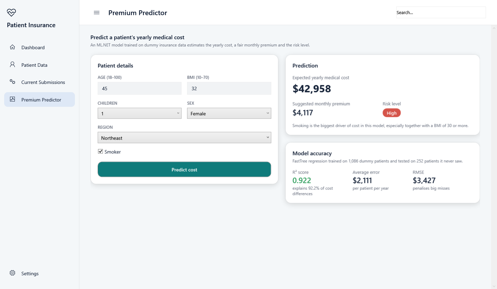
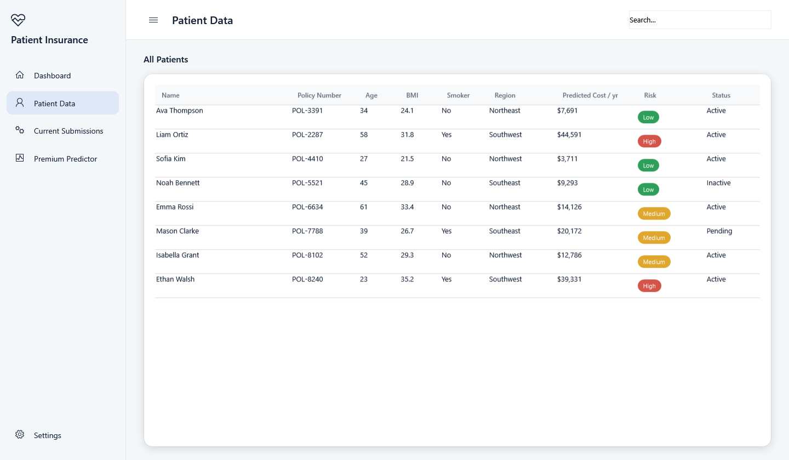

# Patient Insurance

A Windows desktop app (WPF, .NET 8) for managing patient insurance: a
dashboard of claims and renewals, a patient list, and a **machine learning
premium predictor** built with [ML.NET](https://dotnet.microsoft.com/apps/machinelearning-ai/ml-dotnet).

## Features

- **Dashboard**: patient, policy, claim and premium totals, recent claims, a
  claims-by-status chart and upcoming renewals
- **Patient Data**: every patient with their predicted yearly medical cost and
  a Low / Medium / High risk badge
- **Premium Predictor**: enter age, BMI, children, sex, region and smoking
  status to get the expected yearly cost, a suggested monthly premium and the
  risk level
- **Model accuracy card**: R², average error and RMSE measured on patients the
  model never saw while training
- Light and dark themes

## The machine learning model

The model predicts a person's **yearly medical charges** from six inputs:
age, sex, BMI, number of children, smoker, and region.

| Step | What happens |
|---|---|
| Encode | `sex`, `smoker` and `region` are one-hot encoded |
| Features | all inputs are joined into one feature vector |
| Train | FastTree regression (gradient boosted decision trees, 200 trees) |
| Test | 80% of rows train the model, the other 20% measure its accuracy |

Decision trees are used because cost jumps sharply for people who smoke *and*
have a BMI of 30 or more, which a straight-line model cannot capture.

On the dummy data the model scores **R² 0.92**, with an average error of about
**$2,100** a year.

From the predicted cost the app derives:

- **Risk level**: Low under $10,000 a year, Medium under $25,000, High above
- **Monthly premium**: expected yearly cost plus a 15% loading, divided by 12

The model trains in the background each time the app starts (about a second),
so the predictor button turns on shortly after launch.
